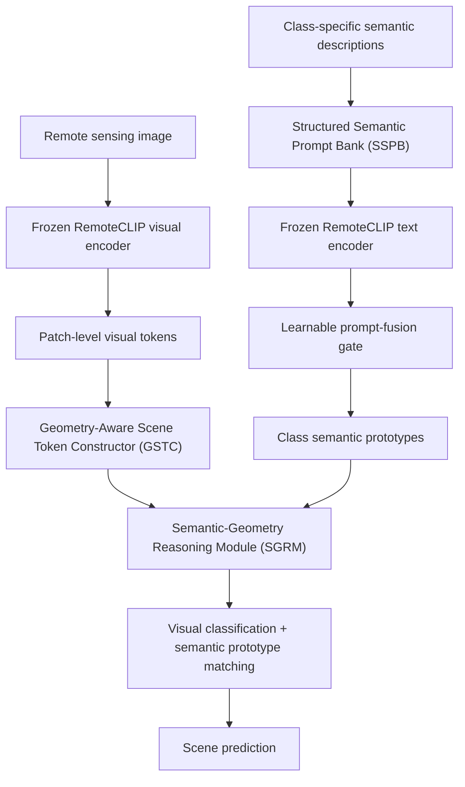

\

# SAGE-Net

### Semantic and Geometry-Aware Foundation Adaptation for Few-Shot Remote Sensing Scene Classification

**Naveed Sultan · Mansoor Hayat · Santitham Prom-on**

\
\
\

\

> [!IMPORTANT]\
> **Code availability:** The source code of SAGE-Net will be made publicly available in this repository **after final acceptance of the manuscript**. The training scripts, evaluation scripts, configuration files, and instructions are not yet released. Please check back for updates.

## Overview

Remote sensing scene classification must distinguish aerial scenes with substantial intra-class diversity, inter-class similarity, changes in image scale, and complex spatial layouts. Models that rely mainly on global appearance or a single class-name prompt can overlook the object composition and geometric arrangements that distinguish visually similar categories.

**SAGE-Net** is a lightweight vision-language adaptation framework for **few-shot remote sensing scene classification**. It uses **frozen RemoteCLIP visual and text encoders** and learns task-specific modules that connect structured semantic descriptions with spatially grounded scene evidence. The goal is to improve classification under limited supervision while preserving the general-purpose representations of the pretrained foundation model.

## Method at a Glance

SAGE-Net comprises three principal adaptation components:

| Component                                         | Purpose                                                                                                                                                                                                                      |
| ------------------------------------------------- | ---------------------------------------------------------------------------------------------------------------------------------------------------------------------------------------------------------------------------- |
| **Structured Semantic Prompt Bank (SSPB)**        | Represents each scene class using **identity**, **object-composition**, and **geometry-layout** prompts. The frozen text encoder produces embeddings, and a learnable gate fuses them into a class-level semantic prototype. |
| **Geometry-Aware Scene Token Constructor (GSTC)** | Softly groups visual patch features into compact scene-component tokens and augments them with **centroid**, **area**, **aspect ratio**, and **orientation** information.                                                    |
| **Semantic-Geometry Reasoning Module (SGRM)**     | Models pairwise relationships using geometry-biased attention and aggregates class-specific evidence by matching refined scene tokens with semantic prototypes.                                                              |

The final prediction combines discriminative visual evidence with semantic prototype alignment. The adaptation modules are optimized using cross-entropy and semantic alignment objectives while the RemoteCLIP encoders remain frozen.

## Experimental Scope

The manuscript considers the following datasets and evaluation settings:

| Dataset                | Role in the study                                                 |
| ---------------------- | ----------------------------------------------------------------- |
| **NWPU-RESISC45**      | Few-shot adaptation and source dataset for cross-dataset transfer |
| **AID**                | Few-shot adaptation and cross-dataset transfer target             |
| **UC-Merced Land Use** | Cross-dataset transfer target                                     |

- **Few-shot recognition:** 5-way 1-shot and 5-way 5-shot evaluation.
- **Cross-dataset transfer:** Transfer from NWPU-RESISC45 to semantically matched classes in AID and UC-Merced Land Use.
- **Frozen encoders:** RemoteCLIP visual and text branches; only lightweight adaptation modules are optimized.

The complete evaluation protocol, configuration files, and reproducibility instructions will be provided with the code release.

## Planned Code Release

We intend to add the following materials after final acceptance, subject to dataset and pretrained-checkpoint redistribution terms:

- [ ] Model definitions for SSPB, GSTC, SGRM, and the classification head
- [ ] Training and evaluation scripts
- [ ] Dataset preparation and few-shot sampling instructions
- [ ] Experiment configurations and reproducibility settings
- [ ] Cross-dataset transfer evaluation instructions
- [ ] Pretrained-model setup and checkpoint guidance

**Please note:** This repository currently serves as the project information page. It should not yet be interpreted as a runnable implementation.

## Citation

If you find the research useful, please cite the SAGE-Net manuscript once its bibliographic information becomes available. The complete citation and BibTeX entry will be added after publication.

**Manuscript title:** *SAGE-Net: Semantic and Geometry-Aware Foundation Adaptation for Few-Shot Remote Sensing Scene Classification*.

## Acknowledgments

We sincerely thank **Mainak Singha, Ankit Jha, Bhupendra Solanki, Shirsha Bose, and Biplab Banerjee**, the authors of **[APPLeNet](https://github.com/mainaksingha01/APPLeNet)**, for generously making their source code publicly available. Their open research resources have provided a valuable reference and helped accelerate research and experimentation in few-shot remote sensing scene understanding. Open-source contributions of this kind support reproducibility, facilitate meaningful comparisons, and encourage continued progress across the remote sensing research community.

We also acknowledge the authors and maintainers of **[RemoteCLIP](https://github.com/ChenDelong1999/RemoteCLIP)** for releasing pretrained vision-language models for remote sensing research.

These acknowledgments recognize the valuable resources shared by the research community; **SAGE-Net's SSPB, GSTC, and SGRM constitute the methodology described in our manuscript**.

## License and Contact

The license and any notices required for third-party code will be provided when the implementation is released. For research-related questions, please use the repository's GitHub Issues page once enabled, or contact the authors through their institutional channels.

---

\

**SAGE-Net · Department of Computer Engineering, King Mongkut's University of Technology Thonburi (KMUTT), Thailand**

\

